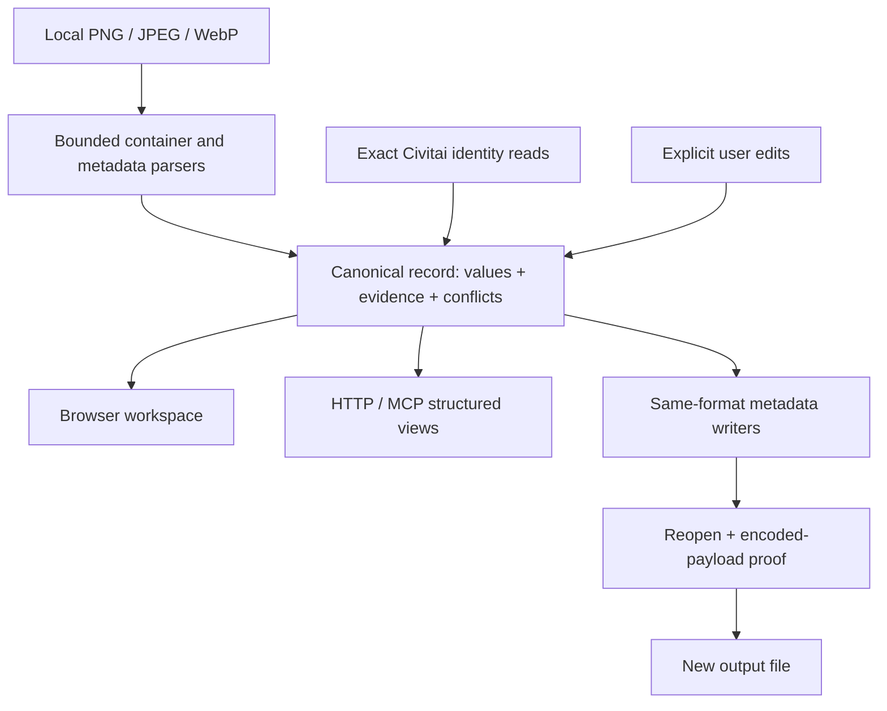

# One engine, three interfaces

**Outcome:** find the right implementation boundary without building a second metadata system.

The portable browser, HTTP service, and MCP server share the same parsers, canonical record, resolver, editing logic, and writers. `src/engine.mjs` imports those modules in order and exports the shared engine; the HTML build adds the browser UI.

In words: inputs become one evidence-bearing record; every interface edits that record, and exports use the shared writers and integrity checks. The original image and original ComfyUI carrier bytes are not reconstructed from UI text.

## Source map

| Area | Main files | Responsibility |
| --- | --- | --- |
| Constants and shared entry | `src/core/constants.js`, `src/engine.mjs` | Version, fields, roles, limits, ordered engine imports. |
| Canonical boundary | `src/core/canonical.js` | Merge sources, field provenance, resources, conflicts, projections. |
| Graph interpretation | `src/core/comfy.js` | Output-bound active traversal and supported node semantics. |
| Identity grammar/contract | `src/core/air.js`, `src/core/civitai-contract.js` | AIR parsing, catalog/file-role compatibility, normalization. |
| Catalog reads/cache | `src/core/civitai.js`, `src/core/identity-cache.js` | Exact resolution, coalescing, cooldown, bounded public storage. |
| Containers | `src/formats/png.js`, `jpeg.js`, `webp.js` | Signature/container reading and same-format metadata rewriting. |
| EXIF and parameters | `src/core/exif.js`, `src/core/a1111.js` | Supported carriers and compatibility text. |
| Edits and integrity | `src/core/editing.js`, `src/core/integrity.js` | Shared validation/history helpers and protected-payload hashing. |
| Browser interaction | `src/app/state.js`, `ui.js`, `main.js`, `src/styles.css` | Queue, state transitions, semantic controls, rendering. |
| Companion | `automation/service.mjs`, `schemas.mjs`, `http.mjs`, `mcp.mjs` | Permissions, sessions/revisions, strict contracts, transports. |
| Packaging | `scripts/build.mjs`, `package-release.mjs`, verification scripts | Portable HTML, CSP, license, ZIP, checksums, attestations. |

Browse the [source tree](https://github.com/chriscollins500/civitai-metadata-studio/tree/main/src) and [automation implementation](https://github.com/chriscollins500/civitai-metadata-studio/tree/main/automation).

## Record concepts

A canonical generation value is more than text: it has a source, evidence, confidence, and edited state. Resources carry roles, identity candidates, hashes, AIR origins, verification diagnostics, and conflicts. Actual image facts are separate from editable generation claims.

The internal schema is `civitai-metadata-studio.record`. The HTTP/MCP view is a deliberately shaped contract, not a promise that every internal property is public or stable. Identity-exchange JSON has its own schema and is not a serialization of an entire editing session.

## Projection rules matter

Fix a disagreement at the canonical boundary rather than independently patching A1111, EXIF, and Civitai output. Structured output can retain unresolved evidence; parser-facing resource identity fields require positive, role-compatible verification.

The A1111 short-hash preference is a compatibility projection, not the engine's operational identity order. Original ComfyUI JSON remains a historical carrier, not a mutable projection of the current form fields.

## State transitions and trust

The browser owns its queue/history in memory. The companion adds opaque sessions, revision checks, atomic rollback, permitted roots, and explicit export authority. Exact network enrichment can update identity evidence, but neither network text nor embedded metadata can execute code or expand permissions.

Persistent storage is limited to sanitized public identity data. Keep credentials, image bytes, private prompts, and workflows out of the cache model when extending it.

## Extension checklist

For a new field, format, node type, or endpoint: add shared validation and provenance; preserve ambiguity; test round trips and malformed input; check privacy projections; verify the built HTML separately; and update API/MCP/docs from the same contract. A new format requires a measured payload-preservation strategy, not a canvas conversion disguised as metadata-only editing.

**Next:** [Development and testing](https://github.com/chriscollins500/civitai-metadata-studio/wiki/Development-and-Testing) · [Contributing](https://github.com/chriscollins500/civitai-metadata-studio/wiki/Contributing-and-Support)
