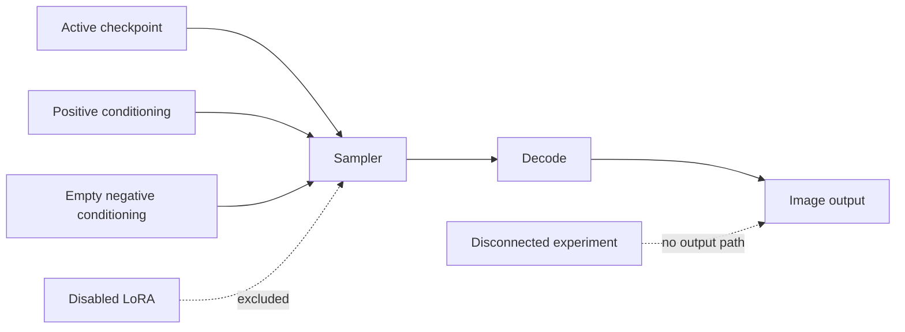

# Reading the workflow that mattered

**Outcome:** understand why a resource is listed—and why an unused node should not be.

ComfyUI can embed two different kinds of JSON: an executable **prompt graph** and a visual **workflow** with node positions, widgets, and links. A node's presence on the canvas does not prove that it contributed to the saved image.

## Active paths, not a shopping list

Studio starts at recognized output nodes and follows their upstream dependencies. It does not collect every checkpoint or LoRA filename it can find anywhere in the JSON.

In words: only the connected, active path into an actual output supplies resource claims. Disabled and disconnected experiments are excluded. If no trustworthy output root is available, Studio does not invent one to produce a more impressive resource list.

## Controls that affect discovery

| Workflow state | Expected interpretation |
| --- | --- |
| Disconnected node | Not part of the output's ancestry; excluded. |
| Muted or bypassed node, including modes 2/4 | Does not contribute its own inactive resource. |
| Explicitly disabled resource slot | Excluded, including supported nested rgthree controls. |
| Zero-strength LoRA slot | Excluded when the supported node semantics establish it is inactive. |
| Literal switch or linked primitive control | Follow the selected branch when its value is resolvable. |
| Dynamic switch with unresolved runtime behavior | Emit a diagnostic; do not claim every alternative was used. |

Custom-node semantics are finite. A newly invented loader or switch may need a dedicated parser rule and regression fixture. “Connected” is necessary evidence, not universal knowledge of every extension's execution behavior.

## Why an empty negative prompt stays empty

Some workflows pass positive text through a conditioning-zeroing or empty-conditioning node to create the negative input. Copying the upstream text would falsely duplicate the positive prompt. Studio recognizes supported zero/empty conditioning and keeps the negative blank.

If both prompts genuinely contain the same text, the editor does not reject that choice based on appearance alone. Inspect the source labels, original graph, and any conflicts before changing it.

## Multiple outputs and historical uncertainty

A graph can contain several saves, branches, or intermediate images. Without enough saved evidence to bind a particular output to this file, graph reachability cannot establish every historical detail. Warnings and unresolved branches should remain visible, not be turned into confident identities.

Exact Civitai verification answers a different question: **which public resource matches this identifier?** It cannot prove that a particular branch executed when the image was created.

## Sidecars and preserved graphs

The browser does **not** automatically pair an image with a nearby JSON file. Its JSON identity importer is not a general ComfyUI workflow importer. Developer sidecar regressions can compare explicitly supplied image/JSON pairs; that is a testing capability, not an automatic browser feature.

When saving, original embedded ComfyUI prompt/workflow carriers remain byte-for-byte unchanged. Editing a prompt in Studio changes the canonical generation record and its new projections; it does not rewrite the historical graph or make it regenerate the edited recipe.

## Reporting a workflow mistake

Describe the expected output branch, relevant loader/switch node classes, enabled state, and actual resource result. Prefer a minimal synthetic workflow without private prompts or paths. Include the app version and whether the issue occurs before or after Civitai verification.

**Related:** [Resources and identity](https://github.com/chriscollins500/civitai-metadata-studio/wiki/Resources-and-Identity) · [Conflicts and provenance](https://github.com/chriscollins500/civitai-metadata-studio/wiki/Conflicts-and-Provenance) · [Development and testing](https://github.com/chriscollins500/civitai-metadata-studio/wiki/Development-and-Testing)
