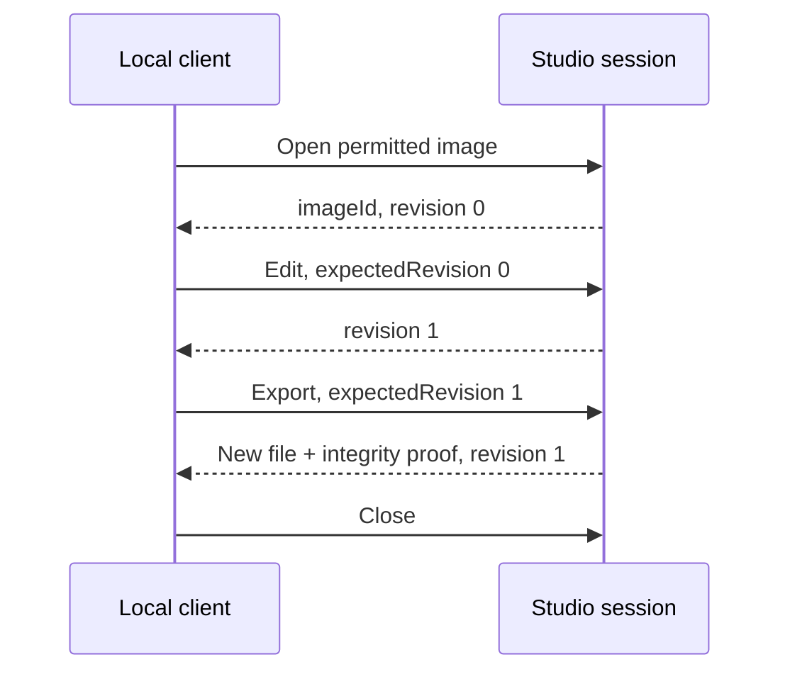

# Local HTTP API reference

**Contract:** OpenAPI **3.2.1**. Base URL: `http://127.0.0.1:4318` unless configured otherwise.

The authoritative machine-readable contracts are the running server's `/openapi.json` and the [generated repository schema](https://github.com/chriscollins500/civitai-metadata-studio/blob/main/docs/openapi.json). Shared strict schemas validate both HTTP and MCP arguments; unknown properties are rejected.

## Transport and authentication

All `/v1` operations require `Authorization: Bearer <local-process-token>`. POST/PATCH bodies must be JSON objects with `Content-Type: application/json`. The token is not a Civitai credential. Browser-origin requests and an unexpected Host header are rejected. See [setup](https://github.com/chriscollins500/civitai-metadata-studio/wiki/Automation-Setup).

`GET /health` returns a small status/version response. `GET /openapi.json` returns the schema. Neither exposes private sessions or requires bearer authentication.

## All 14 operations

`imageId` is an opaque UUID returned by `open_image`; it is not a Civitai public image ID.

| Method and path | Operation ID | Arguments beyond the path |
| --- | --- | --- |
| `GET /v1/capabilities` | `capabilities` | None. Formats, fields, permissions, limits, guarantees. |
| `GET /v1/civitai/reference` | `civitai_reference` | None; network opt-in required. |
| `POST /v1/images` | `open_image` | `path`; optional `includePrompts` (false). |
| `GET /v1/images/{imageId}` | `read_image` | Optional query `includePrompts=true` or `false`. |
| `PATCH /v1/images/{imageId}` | `edit_image` | `expectedRevision`; optional `fields`, `resources`, `removeResources`, `preserve`. |
| `DELETE /v1/images/{imageId}` | `close_image` | None; forgets session, not files. |
| `POST /v1/images/{imageId}/undo` | `undo_image` | `expectedRevision`. |
| `POST /v1/images/{imageId}/redo` | `redo_image` | `expectedRevision`. |
| `POST /v1/images/{imageId}/verify` | `verify_image` | `expectedRevision`; network opt-in required. |
| `POST /v1/images/{imageId}/import` | `import_civitai_metadata` | `expectedRevision`, positive numeric `civitaiImageId`; network opt-in required. |
| `POST /v1/images/{imageId}/export` | `export_image` | `expectedRevision`; optional `filename`, `suffix` (default `_metadata`); write root required. |
| `GET /v1/images/{imageId}/report` | `report_image` | Optional query `includePrompts=true` or `false`. |
| `POST /v1/resources/search` | `search_resources` | `query`, trimmed length 2–200; network opt-in required. |
| `POST /v1/models/hash` | `hash_model` | Permitted local-file `path`; no model upload. |

## Session and revision rules

Opening returns revision `0`. Edit, undo, redo, verification, and public-image import require the current revision and increment it on success. Export requires the current revision but **does not increment it**. Closing does not require a revision.



Read, review, mutate with the returned revision, then export with the latest revision. Do not assume that an unchanged-looking verification result leaves the revision unchanged.

Responses with revisions include `ETag: "n"`. Mutating requests can use `If-Match: "n"` instead of a body revision; if both are present they must agree. This is not a general conditional-GET interface—do not send `If-Match` on reads.

## Atomic edit shape

```json
{
  "expectedRevision": 0,
  "fields": {"steps": 12, "seed": "18446744073709551615"},
  "resources": [{"key": "existing-resource-key", "values": {"name": "Reviewed resource"}}],
  "removeResources": [],
  "preserve": {"existing-metadata-item-id": false}
}
```

Use actual keys/metadata IDs returned by your session. Omit a resource `key` to add a resource. Invalid edits roll back as one transaction. The [16 field keys](https://github.com/chriscollins500/civitai-metadata-studio/wiki/Generation-Fields) accept strings or finite numbers; seeds should be strings. Blank values are supported according to canonical validation.

Resource values can include `name`, `role`, `type`, `versionName`, `baseModel`, `rawAir`, positive numeric `modelId`, `modelVersionId`, `fileId`, finite `weight`, `sourceUrl`, and algorithm-keyed `hashes`. Hash keys are `SHA256`, `BLAKE3`, `AutoV3`, `AutoV2`, `CRC32`, `AutoV1`; canonical validation enforces meaning/length. Roles are listed in [Resources and identity](https://github.com/chriscollins500/civitai-metadata-studio/wiki/Resources-and-Identity).

An identity edit invalidates previous proof; it does not automatically call Civitai. Preservation cannot force an unsupported/private entry to be retained.

## Record and export responses

A record contains `imageId`, `revision`, basename `filename`, `format`, byte count, actual `dimensions`, animation flag, `fields`, `resources`, verification summary, conflicts, warnings, validation issues, preservation choices, history counts, and `promptsIncluded`.

Field entries carry `value`, `source`, `evidence`, `confidence`, and `edited`. Actual `dimensions` are distinct from editable generation width/height. Prompts and prompt-related changes/conflicts are omitted by default; `includePrompts=true` is an explicit disclosure choice, not permission to publish everything else.

Export returns `filename`, `bytes`, complete-file `sha256`, `integrity`, `originalUnchanged: true`, and the unchanged revision. Export refuses an existing destination, validates the source format, and proves protected encoded payload equality before writing.

## Idempotency and bounded work

An `Idempotency-Key` of at most 128 characters reuses a successful result for five minutes. There are at most 128 remembered entries, in memory only. Repeating a key with different arguments returns `idempotency_conflict`; failed calls are not kept as successful results. Use the same key when resolving an uncertain transport outcome, not to request another edit/export.

Limits include 2 MiB JSON, four active HTTP operations, 120 authenticated requests/minute, 32 connections, 8 KiB headers, and 32 sessions with 30-minute idle expiry. HTTP operations have a 120-second cancellation controller; provider requests have their own shorter deadlines. These are not a promise that every filesystem operation completes instantly after cancellation.

## Errors

Errors use `application/problem+json` with `type`, `title`, `status`, stable `code`, and random `requestId`. Known validation errors expose safe explanations; unexpected failures do not return stack traces or source paths.

| Status / example code | Interpretation |
| --- | --- |
| 400 / `invalid_json`, `invalid_precondition` | Malformed object or revision header. |
| 401 / `unauthorized` | Missing/wrong local token. |
| 403 / `invalid_host`, `origin_denied` | Loopback/client boundary rejected. |
| 404 / `not_found` | Unknown route or unavailable session, according to code. |
| 409 / `revision_conflict`, `idempotency_conflict` | Review current state or key usage. |
| 413 / `body_limit` | JSON exceeds the request bound. |
| 415 / `content_type` | Send JSON. |
| 422 / `invalid_arguments` | Strict argument schema rejected the request. |
| 429 / `request_limit` | Local request budget; distinct from Civitai cooldown. |
| 503 / `busy` | Active-operation capacity reached. |

Not every upstream Civitai status is passed through unchanged. Inspect the operation result/problem code and do not interpret a generic error as a verified negative identity.

**Next:** [Working recipes](https://github.com/chriscollins500/civitai-metadata-studio/wiki/API-Cookbook) · [MCP parity](https://github.com/chriscollins500/civitai-metadata-studio/wiki/MCP-Guide)
