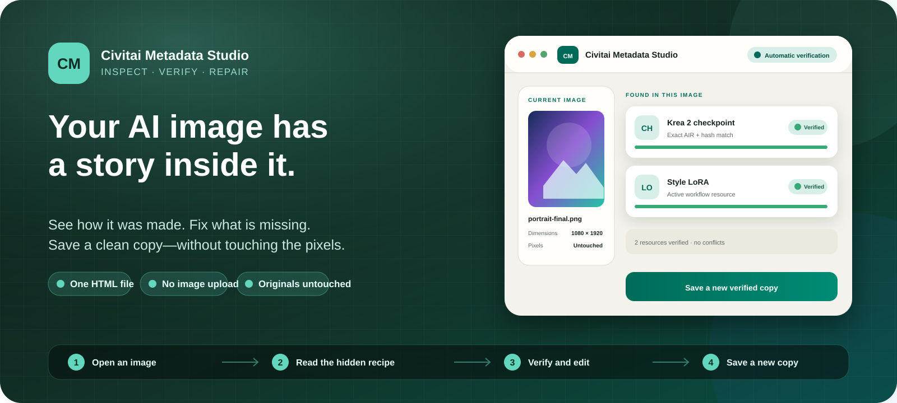

# Your image. The whole story.

**Open an AI image. Understand its recipe. Fix the record. Save a clean copy.**

Civitai Metadata Studio reveals the generation information hidden inside an image: prompts, model references, seeds, settings, and sometimes an entire ComfyUI workflow. It organizes that evidence, checks exact resource identities against Civitai when possible, and lets you save corrected metadata without re-encoding the image or animation payload.

The main app is **one portable HTML file**. No installer, account, or image uploads. The optional API/MCP companion is a separate way for scripts and assistants to use the same engine.

<a href="https://chriscollins500.github.io/civitai-metadata-studio/app/"><strong>Try the editor</strong></a> · <a href="https://github.com/chriscollins500/civitai-metadata-studio/releases/latest/download/civitai-metadata-studio.zip"><strong>Download the portable app</strong></a> · <a href="https://github.com/chriscollins500/civitai-metadata-studio/wiki/Getting-Started">Start in 30 seconds</a> · <a href="https://github.com/chriscollins500/civitai-metadata-studio/wiki/Documentation-Map">Explore every guide</a>

## Choose your path

| You want to… | Start here | Then explore |
| --- | --- | --- |
| Open your first image | [Getting started](https://github.com/chriscollins500/civitai-metadata-studio/wiki/Getting-Started) | [Workspace and keyboard](https://github.com/chriscollins500/civitai-metadata-studio/wiki/Workspace-and-Keyboard) |
| Correct prompts or settings | [Generation fields](https://github.com/chriscollins500/civitai-metadata-studio/wiki/Generation-Fields) | [Saving and pixel integrity](https://github.com/chriscollins500/civitai-metadata-studio/wiki/Saving-and-Pixel-Integrity) |
| Identify a checkpoint, LoRA, or VAE | [Resources and identity](https://github.com/chriscollins500/civitai-metadata-studio/wiki/Resources-and-Identity) | [AIR and hashes](https://github.com/chriscollins500/civitai-metadata-studio/wiki/AIR-and-Hashes) |
| Understand a ComfyUI image | [Workflow handling](https://github.com/chriscollins500/civitai-metadata-studio/wiki/ComfyUI-Workflow-Handling) | [Conflicts and provenance](https://github.com/chriscollins500/civitai-metadata-studio/wiki/Conflicts-and-Provenance) |
| Share a file responsibly | [Privacy and security](https://github.com/chriscollins500/civitai-metadata-studio/wiki/Privacy-and-Security) | [Reports and identity exchange](https://github.com/chriscollins500/civitai-metadata-studio/wiki/Batch-and-Identity-Exchange) |
| Connect a script or assistant | [Automation setup](https://github.com/chriscollins500/civitai-metadata-studio/wiki/Automation-Setup) | [HTTP API](https://github.com/chriscollins500/civitai-metadata-studio/wiki/HTTP-API-Reference) · [MCP](https://github.com/chriscollins500/civitai-metadata-studio/wiki/MCP-Guide) |
| Investigate a problem | [Troubleshooting](https://github.com/chriscollins500/civitai-metadata-studio/wiki/Troubleshooting) | [Capabilities and limits](https://github.com/chriscollins500/civitai-metadata-studio/wiki/Capabilities-and-Limitations) |
| Contribute or audit a release | [Architecture](https://github.com/chriscollins500/civitai-metadata-studio/wiki/Architecture-and-Data-Model) | [Testing](https://github.com/chriscollins500/civitai-metadata-studio/wiki/Development-and-Testing) · [Release provenance](https://github.com/chriscollins500/civitai-metadata-studio/wiki/Release-and-Provenance) |

## Four promises worth understanding

**Your originals stay original.** Browser exports are new downloads; the companion exclusively creates new output files and refuses overwrites.

**Pixels are not generation settings.** Width and height begin with the actual image dimensions. Editing those fields changes metadata, not the picture's resolution.

**A name is a clue, not proof.** Exact identifiers and hashes can establish resource identity. Names, filenames, visual resemblance, and prompt tags cannot do that alone.

**Verification has boundaries.** A matching Civitai resource is not proof of authorship, licensing permission, historical model usage, or the truth of every embedded claim.

## A safe first session

1. Open the portable HTML and choose a PNG, JPEG, or WebP.
2. Review **Generation**, **Resources**, **Other metadata**, and **Review**.
3. Keep automatic verification on, or turn it off for local-only inspection.
4. Make an edit, leave **Verify pixel integrity** enabled, and save a new copy.
5. Reopen the copy and inspect the result before sharing it.

> **Privacy reminder:** original ComfyUI carriers are deliberately preserved. They may contain private notes or local paths. A privacy-first export is not a forensic anonymizer.

## About this documentation

This wiki documents the **1.0.0 application** and current release infrastructure. Guides distinguish implemented behavior, tested evidence, and limitations. The [documentation map](https://github.com/chriscollins500/civitai-metadata-studio/wiki/Documentation-Map) lists every chapter, its audience, primary sources, and maintenance process. Examples use synthetic data and illustrative paths—not private images or credentials.
